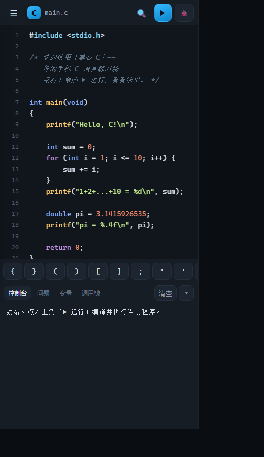
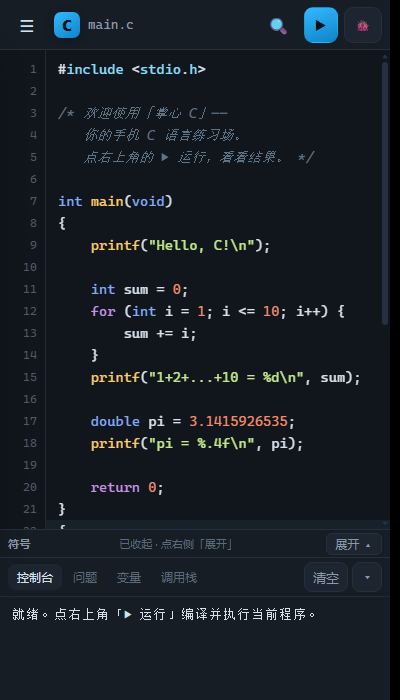

# 掌心 C · 手机上写 C 语言

一个可以装进手机桌面的 **C 语言练习环境**：写代码、编译（检查）、运行、打断点单步调试，全部在手机浏览器里完成，**不需要联网、不需要云端编译器**。

> 面向学习与练习：覆盖 C89/C99 的常用写法（指针、结构体、数组、递归、字符串、`scanf` 交互输入……），内置一个自己写的 C 解释执行引擎，点「运行」立刻出结果。

**在线直接打开**（不用装、不用下载）：<https://y-steve-dragon.github.io/cstudio/>
**想完全离线**：下载仓库里的 `palm-c-offline.html`，一个文件就是整个应用（见下文方式 A）。

---

## 一、怎么在手机上打开

### 方式 A：完全离线 —— 一个 HTML 文件搞定（最省事，也不用电脑一直开着）

本目录里有一个 **`palm-c-offline.html`**（约 280 KB），它就是整个应用：界面、样式、C 引擎全装在这一个文件里。

1. 用 **USB 数据线**把手机连电脑，把这个 `palm-c-offline.html` 拷进手机的「下载」目录。
   （也可以先发到微信/QQ 的「文件传输助手」，手机上下载下来；之后就一直不用网了。）
   懒得连线也行：直接在手机上打开 <https://github.com/Y-steve-dragon/cstudio/releases/download/v1.0.0/palm-c-offline.html> 下载。
2. 手机上用**浏览器**（Chrome / Edge / 夸克 / 系统自带都行）打开这个文件：
   文件管理器里点一下这个 html，选「用浏览器打开」。
3. 之后就能直接写、直接跑。**没有服务器、没有网络、没有安装包**，飞机上、地铁里都能用。

> 想要桌面图标：Chrome 里打开后菜单 →「添加到主屏幕」；如果你的浏览器不支持对本地文件这样做，
> 就把这个 html 的快捷方式放到桌面，效果一样。
> 想改代码就重新生成：电脑上运行 `node tools/build-offline.mjs`，再把新文件拷过去。

### 方式 B：手机和电脑连同一个 Wi-Fi（想多设备同步 / 想用最新版时）

1. 电脑上装好 Node.js（18 以上）。
2. 双击本目录里的 **`启动手机版.bat`**。
3. 窗口里会打印几行地址，例如：

   ```
   电脑本机：  http://localhost:8080/
   手机访问：  http://192.168.1.7:8080/
   ```

4. 手机浏览器（Chrome / Edge / Safari / 微信内也能开）输入那个 `http://192.168.x.x:8080/` 地址。
5. 打开后点浏览器的「添加到主屏幕」→ 以后就像 App 一样，一点就进。

> 打不开的话：① 看电脑防火墙是否拦了 8080 端口；② 确认两台设备在同一个 Wi-Fi（手机别连 4G）。

### 方式 C：放到任意静态网站上

把整个 `CStudio` 目录上传到任意支持静态文件的托管（GitHub Pages / 对象存储 / 自己的 nginx）即可。
它是纯前端 + Service Worker，**第一次打开后可以离线使用**（断网也能写、也能跑）。

---

## 二、界面速览



（390 px 宽的手机视口实际效果；按钮在窄屏下自动只留图标。）

```
┌──────────────────────────────────────────┐
│ ☰  [C] main.c        🔍   ▶ 运行   🐞 调试 │  ← 顶栏
├──────────────────────────────────────────┤
│ main.c │ struct.c │ …                    │  ← 标签页
│ 1  #include <stdio.h>                     │
│ 2                                         │
│ 3  int main(void) {                       │  ← 编辑区
│ 4      printf("Hello, C!\n");             │    （行号 + 断点）
│ 5      return 0;                          │
│ 6  }                                      │
├──────────────────────────────────────────┤
│ { } ( ) [ ] ; " '  +  -  …                │  ← 符号栏（手机专用）
├──────────────────────────────────────────┤
│ 控制台 │ 问题 0 │ 变量 │ 调用栈            │  ← 下方面板
│ Hello, C!                                 │
│ ──── 运行结束 · 12 步 · 8 ms ────          │
└──────────────────────────────────────────┘
```

- **☰ 菜单**：文件列表（新建 / 重命名 / 设为入口 / 下载 / 删除）、示例、设置（主题、字号、缩进、自动换行、行号）。
- **🔍 查找**：查找 / 替换（支持全部替换）。
- **▶ 运行**：编译并运行，输出在「控制台」，编译错误在「问题」。
- **🐞 调试**：进入调试模式，点行号打红点断点；暂停后可「继续 / 进入 / 跳过 / 跳出」，右侧看「变量」和「调用栈」。
- **符号栏**：手机上打 `{}` `[]` `;` `"` 很麻烦，点一下即可插入（缩进/换行/`/* */`/`scanf`/`printf` 都在里面）。一排放不下，所以：**右侧「收起 ▾」可折起来**（折起后只占一条细栏）；内容**左右滑动**查看，也可以点头栏的 **‹ ›** 翻页，桌面端支持滚轮和拖动。
  <br>

### 快捷键（接键盘 / 平板时）
| 按键 | 作用 |
|---|---|
| `Ctrl` + `Enter` | 运行 |
| `Ctrl` + `S` | 保存（其实会自动保存） |
| `Ctrl` + `F` | 查找 |
| `Ctrl` + `/` | 注释/取消注释选中行 |
| `F5` | 运行（调试快捷键见下） |
| `F10` / `F11` | 跳过（单步越过） / 进入 |

---

## 三、它能做什么

**编辑器**
- C 语法高亮、行号、自动缩进、括号自动配对、当前行高亮
- 多文件工程（`.c` / `.h`）+ 指定入口文件；数据自动存在浏览器本地
- 断点、错误行高亮、搜索行高亮
- 深色 / 浅色 / 午夜三套主题，字号与缩进可调，可开关自动换行

**编译与运行**
- 自研引擎：词法 → 预处理（`#include` `#define` `#if…`）→ 语法/类型检查 → 解释执行
- 编译诊断给 **文件名 + 行 + 中文说明**，点「问题」条目直接跳到出错行
- 运行期错误（段错误、数组越界、空指针、除零、栈溢出、访问已释放内存……）都有中文说明
- 手机上的可交互 `scanf`：程序跑到需要输入时才向你要输入，而不是事先填
- 「停止」按钮能中断死循环（解释器协作让出 + 1.2 秒兜底杀 Worker）

**调试**
- 断点、暂停、单步进入 / 跳过 / 跳出、继续
- 暂停时查看**变量值**（含结构体 / 数组展开）、**调用栈**、当前暂停位置
- 支持中文断点与中文变量名查看

**标准库**（常用部分，够写课本上的所有练习）
`stdio`（printf/scanf/sprintf/snprintf/puts/fgets/…）· `stdlib`（malloc/free/qsort/bsearch/rand/exit/…）· `string`（strlen/strcpy/strcmp/strtok/…）· `math` · `ctype` · `time` · `stdarg`（可变参数）· `stdbool` · `stdint` · `limits` · `float.h` · `conio`（getch 等）

---

## 四、和 Visual Studio 的关系（诚实说明）

这里做的是**学习工作流**上的对标，不是 IDE 的替代品：

| 能力 | 掌心 C | Visual Studio |
|---|---|---|
| 写代码 / 高亮 / 自动缩进 | ✅ | ✅ |
| 编译错误列表（带行列） | ✅ | ✅ |
| 断点 / 单步 / 变量 / 调用栈 | ✅ | ✅（更强） |
| 多文件工程 | ✅ | ✅ |
| 真正的编译 + 链接（原生机器码） | ❌ 解释执行 | ✅ |
| C++ / 模板 / 标准容器 | ❌ | ✅ |
| 代码补全 / 重构 / Git 集成 | ❌ | ✅ |
| 性能 | 百万次空循环约 5 秒 | 原生速度 |

**它能让你在手机上把课本的每一道 C 语言题写完、调通、看到结果；它不会把你的程序编成 .exe。**

另外为了让 `sizeof` 的答案和你电脑上 VS（x64）一致，数据模型按 Windows 取的：`int` 4 字节、`long` 4 字节、`long long` 8 字节、指针 8 字节、`double` 8 字节。

---

## 五、已知限制

- 不支持完整链接器与多 `.c` 分别编译：要拆多个文件请用 `#include "other.c"` 或写 `.h` 声明。
- 不支持 C++、变长数组（VLA）、位域写入语义、`const` 的强制只读。
- 位运算 / 浮点格式化（`%g` 的末尾去零）为近似实现。
- 引擎是解释执行：**重循环会慢**（桌面 30 万～40 万步/秒，手机约 1/3），课本级程序毫秒级完成。
- 内存上限 32 MiB（静态区 2 MiB + 堆 22 MiB + 栈 8 MiB）。
- 文件保存在浏览器本地（localStorage），**清浏览器数据会丢**；重要代码请用「下载」导出。
- 单文件离线版（方式 A）用 `file://` 打开：个别浏览器不允许本地文件写本地存储，这时代码只在本次打开期间有效
  —— 页面会在控制台明确提示，照提示用「下载 / 导出」备份即可。

---

## 六、开发者信息

```
CStudio/
  index.html              页面骨架
  styles/app.css          全部样式（三套主题）
  js/  app.js             交互装配
       editor.js          编辑器（高亮层 + textarea + 行号 + 断点）
       highlight.js       C 语法高亮
       store.js           文件/设置/断点持久化 + 内置示例
       inline-engine.js   file:// 环境下的主线程引擎外壳（接口与 Worker 一致）
  engine/                  解释执行引擎（浏览器与 Node 共用，ESM，无依赖）
       core.js             类型系统 + 32 MiB 线性内存 + 运行期错误
       lexer.js            词法
       preproc.js          预处理（内置 21 个头文件）
       parser.js           语法 + 类型检查 + 帧布局
       interp.js           异步解释执行（输入、断点、单步）
       builtins.js         标准库实现
       cengine.js          编译/运行的统一入口
       session.js          运行会话（事件流 + 暂停/恢复）
       driver.js           「消息 → 会话」的协议实现（Worker 与内联外壳共用）
       worker.js           Web Worker 外壳
  tests/run.mjs           引擎测试（32 项：语言特性 + 错误处理 + 会话调试）
  tests/ui.mjs            界面层测试（51 项：存储、高亮、示例可编译可运行）
  tests/perf.mjs          性能基准
  tools/                  开发用自检页（e2e.html 是真实浏览器端到端测试，25 项）
  tools/build-offline.mjs 生成单文件离线版（palm-c-offline.html）
  serve.mjs               零依赖静态服务器
  sw.js / manifest.webmanifest   PWA（离线 + 安装到桌面）
  palm-c-offline.html        完全离线版：一个文件就是整个应用（USB 拷进手机即可用）
```

在电脑上跑自测：

```bash
cd CStudio
node tests/run.mjs        # 引擎测试，应输出 “通过 32 / 32”
node tests/ui.mjs         # 界面层自检，51 项
node tests/perf.mjs       # 性能基准
node tools/build-offline.mjs   # 重新生成 palm-c-offline.html（改完代码记得重跑）
node serve.mjs 8080       # 起本地服务器
```

---

## 七、我该怎么练

1. 打开左边的「示例」，先跑一遍 `入门示例`（求和 + 浮点）看效果。
2. 试着改一个数字、加一行 `printf`，点运行看变化。
3. 打开 `断点调试示例`，点第 9 行左侧行号打红点，点「🐞 调试」，程序会在那里停下来 —— 看右边的「变量」，按「跳过」一行一行走。
4. 打开 `交互输入示例`，体验 `scanf` 中途要输入。
5. 自己新建文件写课本习题；写坏了看「问题」面板里的中文报错。

---

## 八、参与与许可

- **许可证：MIT**（见 `LICENSE`）。可以随便用、改、商用、再发布，只要保留版权声明。
- 想改代码：
  ```bash
  node tests/run.mjs     # 引擎的 32 项测试（编译/运行/交互/调试/错误）
  node tests/ui.mjs      # 界面与存储的 51 项测试
  node tests/perf.mjs    # 性能基准（数字随机器不同）
  node tools/check-ui.mjs        # 界面与代码的一致性自检
  node tools/build-offline.mjs   # 改完记得重新生成单文件版
  ```
- 引擎是**自己写的解释器**（`engine/lexer.js` → `preproc.js` → `parser.js` → `interp.js`），不是 WASM 版的真编译器；想换成 tcc/gcc 的 WASM 版是另一条路，欢迎提 issue 讨论。
- 报问题请附：手机型号与浏览器、能复现的最小代码、控制台里的报错原文。
